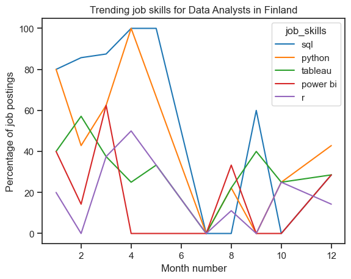

# The Analysis

## 1. What are the most demanded skills for the top 3 most popular data roles in Finland?
Filtering out the popular data roles and getting the top skills for those data roles in Finland. [Click here to see.](2_skills_count.ipynb)

While SQL is more valued in Data Analyst roles in Finland, Python knowledge outshines SQL in Data Engineer and Data Scientist roles. However, Python and SQL have the highest demand across all three roles.

Data Engineers can leverage more technical skills on software platforms like Azure and Snowflake. Data analysts need to know data visualization tools like Tableau and Power BI.

Compared to US, Python is more appreciated skill in Finland for Data Analyst roles. Else than that, other skills for other roles seem to follow the US's trends.

## 2. How job skills are trending for Data Analysts in Finland?
!

During the whole year, SQL is the most requested skill and Python is the second most demanded skill. However, both SQL and Python are more in demand during the first half of the year, and demand decreases during the second half. The trend for Python is especially noticeable.

In the United States, SQL and Python are also the most requested job skills throughout the year, and the demand shows a decreasing trend. This means the trend is similar to Finland, where these skills are most in demand at the beginning of the year.

It should be noted that due to the small sample size in Finland, the results are not as accurate as those for the United States. However, the results can still be used to make estimations.