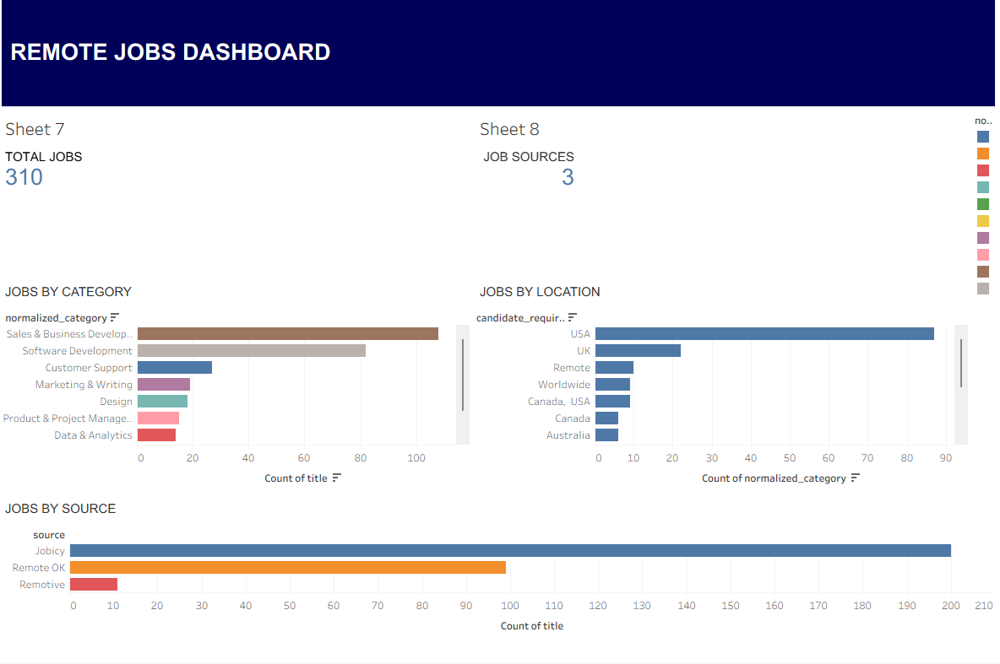
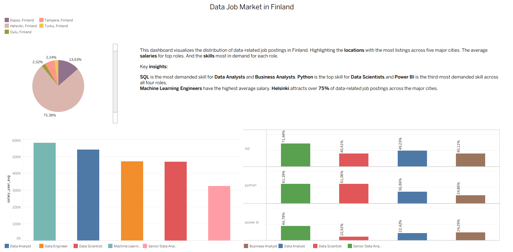
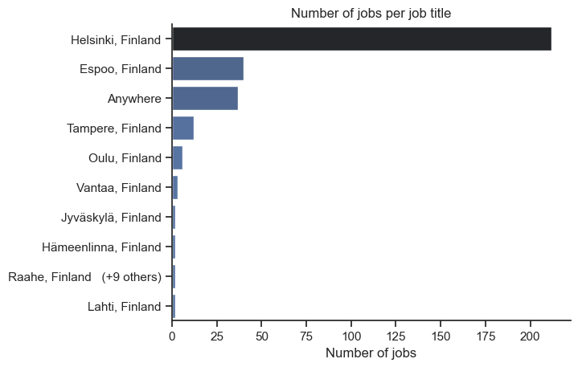
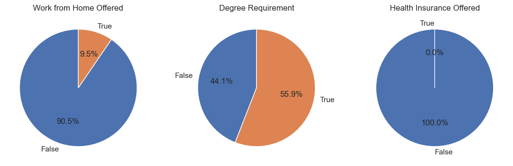
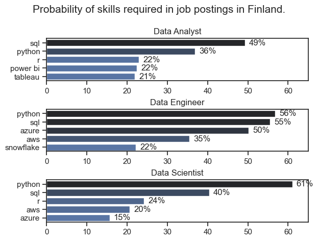
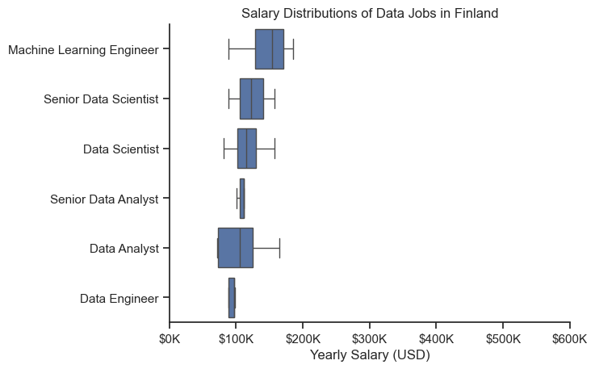
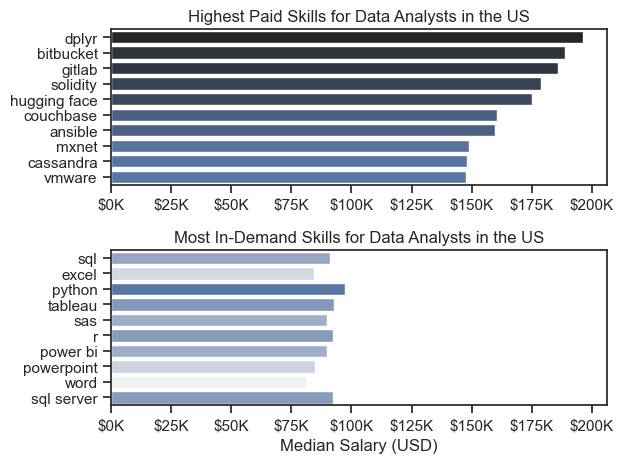
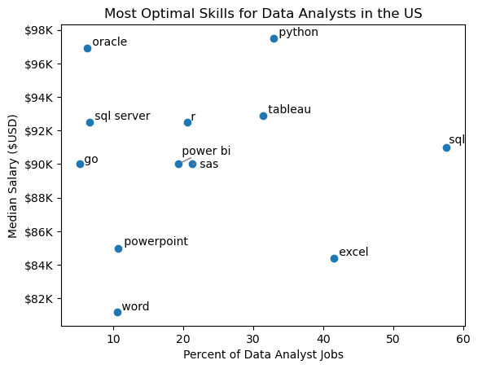

# Job Market Data Pipeline

## Project Overview

This project demonstrates an automated ETL (Extract, Transform, Load) pipeline built with Python. The purpose is to collect remote job postings from the Remotive API, process and clean the data, and store the results in a SQLite database for further analysis.

The project focuses on automating data collection and building a structured data pipeline that can be used for data exploration and reporting.

## Technologies Used

Python – Main programming language

Requests – API integration and data retrieval

Pandas – Data manipulation and transformation

SQLite – Database storage

CSV – Data storage between pipeline stages

Subprocess – Pipeline automation

Pathlib – File path management

Tableau - Dashboard creation

# Python-Tableau Job Market Project

## 1. Where in Finland are the data jobs located and what are the degree requirements?

[Click here to see.](1_EDA_intro.ipynb)

The chart suggests that, by a large margin, most data-related jobs in Finland are located in the capital city of Helsinki. The next highest number of data jobs are in Espoo, while Tampere holds the third position.

First, it should be noted that the data is mainly from 2023, so COVID-19 was no longer a major issue at that time. The share of remote work offered (10%) is relatively low, although still slightly higher than in the United States (8.9%).

Finland’s data job market mostly requires a degree. Most job postings in the data field include a degree requirement (56%), whereas in the United States only about one third (31%) require a degree.

This phenomenon could be partly explained by Finland’s free education system. However, Finland’s tertiary education attainment rate is relatively low compared to peer countries.

## 2. What are the most demanded skills for the top 3 most popular data roles in Finland?
Filtering out the popular data roles and getting the top skills for those data roles in Finland. [Click here to see.](2_skills_count.ipynb)

While SQL is more valued in Data Analyst roles in Finland, Python knowledge outshines SQL in Data Engineer and Data Scientist roles. However, Python and SQL have the highest demand across all three roles.

Data Engineers can leverage more technical skills on software platforms like Azure and Snowflake. Data analysts need to know data visualization tools like Tableau and Power BI.

Compared to US, Python is more appreciated skill in Finland for Data Analyst roles. Else than that, other skills for other roles seem to follow the US's trends.

## 3. How much do jobs pay for Data Analysts?
[Click here to see.](4_salary_analysis.ipynb)
### Salary analysis 

Machine Learning Engineers are the highest-paid data professionals in Finland. Senior Data Scientists are a close second, followed by Data Scientists. The fourth and fifth highest-paid roles are Data Analysts.

### What are the most popular and highest paid skills for Data Analysts?

Due to the sample size being rather low in Finland, the following charts are made from US samples. 

Top-paying skills involve software that requires fairly specialized technical expertise. This suggests that strong proficiency in niche technical skills can lead to higher pay.

However, skills like SQL, Excel, Python, and Tableau are in high demand. This means they are the core skills employers require, while niche technical skills are typically valued on top of these.

## 4. What is the optimal skill for data analyst job markets? 

[Click here to see.](5_optimal_skills.ipynb)

'Percent of Data Analyst jobs' represents the share of job postings that require a particular skill. Skills located in the top-right corner represent the most valuable combination of high demand and high salary, while those in the bottom-left corner represent the least valuable.

Programming tools such as SQL and Python stand out compared to other skills. Analyst tools are also highly valued in the Data Analyst job market, particularly Tableau and Excel.